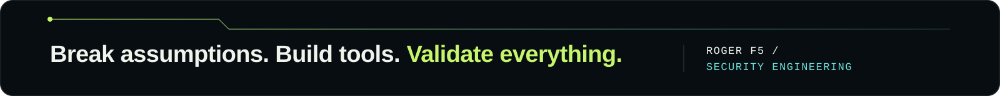

 

**Pentesting · Security Automation · Hardware Hacking**

Soy **Roger Arana / Roger F5**, ingeniero en Sistemas de Guatemala. Desarrollo herramientas de auditoría, automatizo la recolección de evidencias y construyo proyectos que conectan software, radio y sistemas embebidos.

[Evidencia](#01--contribuciones-verificables) · [Proyectos](#02--proyectos-seleccionados) · [Especialidades](#03--del-hallazgo-al-reporte) · [Laboratorio](#04--hardware-en-la-mesa) · [Comunidad](#05--compartir-lo-aprendido)

 

## 01 / CONTRIBUCIONES VERIFICABLES

| Aporte | Evidencia pública |
| :--- | :--- |
| **GitHub Advisory Database · Analyst** | Crédito como **Analyst** en [CVE-2026-54279 / GHSA-2fqr-mr3j-6wp8](https://github.com/advisories/GHSA-2fqr-mr3j-6wp8). Mi [PR #10858](https://github.com/github/advisory-database/pull/10858), integrado, añadió la referencia al parche de aiohttp. |
| **Flipper Zero · Aplicaciones aceptadas** | Tres aportes integrados en el catálogo de Flipper Devices: [NFC QR Presenter #1107](https://github.com/flipperdevices/flipper-application-catalog/pull/1107), [WikiFlip #1086](https://github.com/flipperdevices/flipper-application-catalog/pull/1086) y [Mayan Decoder #1087](https://github.com/flipperdevices/flipper-application-catalog/pull/1087). |
| **RF5 RECON · Extensión publicada** | Disponible en [Chrome Web Store](https://chromewebstore.google.com/detail/ojibelahcinfehgdahcmamkinjjaabgd) y [Firefox Add-ons](https://addons.mozilla.org/en-US/firefox/addon/rf5-recon/). |

 

## 02 / PROYECTOS SELECCIONADOS

<table>
<tr>
<td width="50%" valign="top">

### [Scan Titan ↗](https://github.com/RogerF5-Security/Scan-Titan)

**AUTOMATIZACIÓN DE AUDITORÍAS**

Conecta reconocimiento, evaluación web y herramientas externas en un flujo de trabajo con reportes de vulnerabilidades. La documentación incluye arquitectura, metodología y cobertura.

`Python` `CLI` `Security automation`

[Repositorio](https://github.com/RogerF5-Security/Scan-Titan) · [Arquitectura](https://github.com/RogerF5-Security/Scan-Titan/blob/main/docs/CORE_UPGRADE.md) · [Web del proyecto](https://rogerf5-security.github.io/Scan-Titan/)

</td>
<td width="50%" valign="top">

### [RF5 RECON ↗](https://github.com/RogerF5-Security/RF5-RECON)

**RECONOCIMIENTO DESDE EL NAVEGADOR**

Reúne DNS, headers, políticas de cookies y recursos observados para iniciar una auditoría web. El código Chrome MV3 exporta indicios y evidencia en JSON para su validación.

`JavaScript` `Browser extension` `Web security`

[Código Chrome MV3](https://github.com/RogerF5-Security/RF5-RECON) · [Instalar en Chrome](https://chromewebstore.google.com/detail/ojibelahcinfehgdahcmamkinjjaabgd) · [Firefox](https://addons.mozilla.org/en-US/firefox/addon/rf5-recon/)

</td>
</tr>
<tr>
<td width="50%" valign="top">

### [BLE Scout ↗](https://github.com/RogerF5-Security/BLE-Scout)

**INVENTARIO BLE SIN PORTÁTIL**

Firmware para LILYGO T-Dongle-S3: observación BLE pasiva, dispositivos deduplicados, radar en pantalla y evidencias CSV/HTML en microSD. Incluye un panel web local para consultar resultados.

`C++` `ESP32-S3` `Bluetooth LE`

[Repositorio](https://github.com/RogerF5-Security/BLE-Scout) · [Firmware](https://github.com/RogerF5-Security/BLE-Scout/releases) · [Instalación](https://github.com/RogerF5-Security/BLE-Scout/blob/main/docs/INSTALACION.md)

</td>
<td width="50%" valign="top">

### [NFC QR Presenter ↗](https://github.com/RogerF5-Security/NFC_QR_Presenter)

**UNA TARJETA, DOS FORMAS DE COMPARTIR**

Comparte una URL, contacto o nota desde Flipper Zero mediante QR y NFC NDEF simultáneamente. Gestiona tarjetas en la SD e importa TXT/VCF. Incluye pruebas del almacenamiento y la codificación.

`C` `NFC / NDEF` `Flipper Zero`

[Repositorio](https://github.com/RogerF5-Security/NFC_QR_Presenter) · [Aceptado en el catálogo](https://github.com/flipperdevices/flipper-application-catalog/pull/1107)

</td>
</tr>
</table>

**También en el laboratorio:** [WikiFlip](https://github.com/RogerF5-Security/WikiFlip), diccionario de ciberseguridad offline; [Mayan Decoder](https://github.com/RogerF5-Security/Mayan_decoder), conversión de numeración maya; [Reportes Burp](https://github.com/RogerF5-Security/Reportes-Burp), documentación de hallazgos desde Burp Suite.

[Explorar todos los repositorios →](https://github.com/RogerF5-Security?tab=repositories)

 

## 03 / DEL HALLAZGO AL REPORTE

**Reconocimiento → Validación → Evidencia → Remediación**

| Especialidad | Trabajo técnico |
| :--- | :--- |
| **Pentesting y AppSec** | Evaluación de aplicaciones web, APIs, móvil e infraestructura. Validación de hallazgos y documentación de impacto y remediación. |
| **Desarrollo de herramientas** | Automatización en Python, integración de herramientas CLI, interfaces gráficas, extensiones de navegador y generación de reportes. |
| **Seguridad de IA** | Auditoría de chats y asistentes de IA, validación de hallazgos y documentación de evidencias. |
| **Hardware y wireless** | Laboratorios con RF, BLE, Wi-Fi, NFC/RFID, HID y sistemas embebidos. |

**Credenciales destacadas:** `C)PTE` · `C)PEH` · `CCEP` · `CAIS` · `Cisco Ethical Hacker`

[Credenciales en Credly](https://www.credly.com/users/roger-arana) · [Certificados y trayectoria](https://rogerf5-security.github.io/whoami/)

 

## 04 / HARDWARE EN LA MESA

Del firmware a la pieza física. En [Doggie House](https://github.com/RogerF5-Security/Case-Evil_Doggie), desarrollado en el taller de **Kraken Tres D**, comparto una carcasa impresa en 3D para EvilDoggie con archivos STL, documentación de montaje y [visor 3D](https://rogerf5-security.github.io/Case-Evil_Doggie/).

<strong>Stack y dispositivos del laboratorio</strong>

 

**Desarrollo:** Python · C / C++ · JavaScript · Bash · Git · Docker · Linux · Windows.

**Auditoría:** Burp Suite · OWASP ZAP · Caido · Nmap · Nuclei · Wireshark · Metasploit · Aircrack-ng.

| Área | Dispositivos |
| :--- | :--- |
| **RF · NFC / RFID** | Flipper Zero · Chameleon Ultra |
| **Wi-Fi · BLE** | WiFi Pineapple · Ubertooth One · M5StickC Plus 2 · Marauder |
| **HID · USB · Embebidos** | Rubber Ducky · ESP32 / Espressif · Arduino |

 

## 05 / COMPARTIR LO APRENDIDO

Comparto herramientas, demostraciones y material práctico de seguridad ofensiva y hardware hacking.

**Speaker en Pwn3dCON Community Sessions** con una introducción a Burp Suite, y **facilitador de Hardware Hacking en NicaSecurity Hub · TechClinics**.

| Participación | Evidencia |
| :--- | :--- |
| **FIT Galileo 2026 · Tallerista** | Taller de Flipper Zero. [Presentación y fotos](https://rogerf5-security.github.io/whoami/#comunidad). |
| **Pwn3d Tools 2026 · Ponente** | Herramientas de ciberseguridad y presentación de Scan Titan. [Ver participación](https://rogerf5-security.github.io/whoami/#comunidad). |

[Trayectoria, eventos y certificados →](https://rogerf5-security.github.io/whoami/)

Para reportar una vulnerabilidad en mis proyectos, utiliza el canal privado indicado en su política de seguridad. [Política de este repositorio](SECURITY.md) · [Cómo colaborar](CONTRIBUTING.md).

 

**Código, laboratorio y comunidad.**

[YouTube](https://www.youtube.com/@ROGERF5) · [Twitch](https://www.twitch.tv/rogerf5) · [TikTok](https://www.tiktok.com/@roger_f5) · [Discord](https://discord.gg/9Rp4dskE) · [Instagram](https://www.instagram.com/rogerf5)

 

